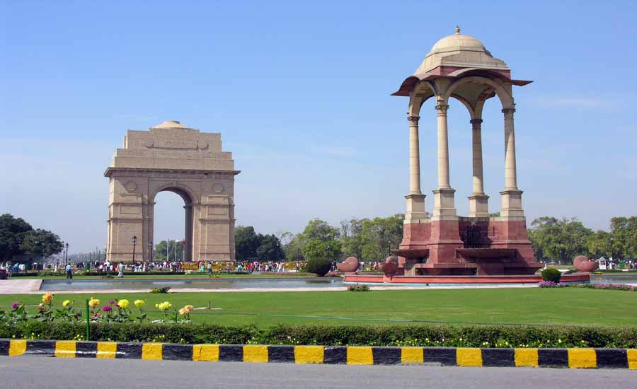
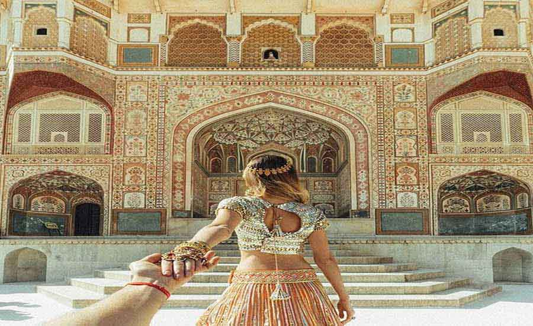

Golden Triangle Tour is such a wonderful tour and the most popular tourist circuit of India. This tour lets you explore the three most adored tourist destinations of India – **Delhi, Agra and Jaipur** – having grandeur, glory and history. The circuit is known as the Golden Triangle because these three cities form a triangular shape on the Indian map.

## Trip to India

The Golden Triangle Tour of India is the gateway to start visiting India, which is full of architecture, history, heritage, culture and much more than your expectations. If you are planning to visit India for the first time, there is no better option than the Golden Triangle Tour. Each city has its own specialty – Delhi is famous for its architecture of the Mughal and British periods and of course its appealing city life, Jaipur is the land of maharajas and world-famous for its palaces, forts and royal touch, and last but not least, Agra is known worldwide for India's pride, the Taj Mahal.

## Delhi Jaipur Agra tour packages

**Delhi** is the national capital of India and has plenty to offer with its historical monuments, excellent shopping centres and mouth-watering street food. India Gate, Parliament Building, President's House, Birla Temple, Qutub Minar, Lotus Temple, Humayun's Tomb, Red Fort and Raj Ghat (the memorial of Mahatma Gandhi) are a few of the numerous monuments in the capital city.

**Jaipur** is another notable gem of the Golden Triangle Tour of India. Owing to a number of forts and palaces, the 'Pink City' remains on the bucket list of avid travelers. Hawa Mahal, Amber Fort and a multitude of heritage hotels are worthy of admiration. Vibrant costumes and scrumptious cuisines will make your trip a memorable one.

**Agra** is a historical city and was a powerful Mughal capital. Agra is renowned in the world because of the Mughal heritage wonder, the Taj Mahal – one of the universally admired masterpieces of the world's heritage. The most loved monument in the world is the outcome of someone's passionate love for his beloved. Built in the 17th century by Shah Jahan, the fifth Mughal emperor, in memory of his wife Mumtaz Mahal, the Taj Mahal is an ode to the emperor's eternal love. With all of its hypnotic and magnetic power, the Taj is simply irresistible. The best time to experience the mesmerizing beauty of the Taj is at sunrise, and a visit at sunset is also rewarding.

All three angles of the Golden Triangle tour have individual identities. Jaipur is known for the forts that represent the bravery of Rajasthani rulers. Agra represents the Mughal culture and the many stories related to their creativity. Delhi, the national capital, is a blend of everything and gives you the taste of the whole of India. Whether you talk about shopping, eating or visiting new places, Delhi is unbeatable, and it enjoys the dominance of Punjabi culture. All three cities will give you different experiences.

## When to go

The best time to visit on a Golden Triangle Tour in India is from October to mid-April. During this period the weather is very pleasant — not too hot and not too cold.

## What to shop for

Delhi, Jaipur and Agra are the best places to shop on your trip. Delhi and Jaipur are both famous for jewelry, carpets, handicrafts and spices. Agra is well known for leather goods, zari-zardozi, marble and stone carving and inlay work.
