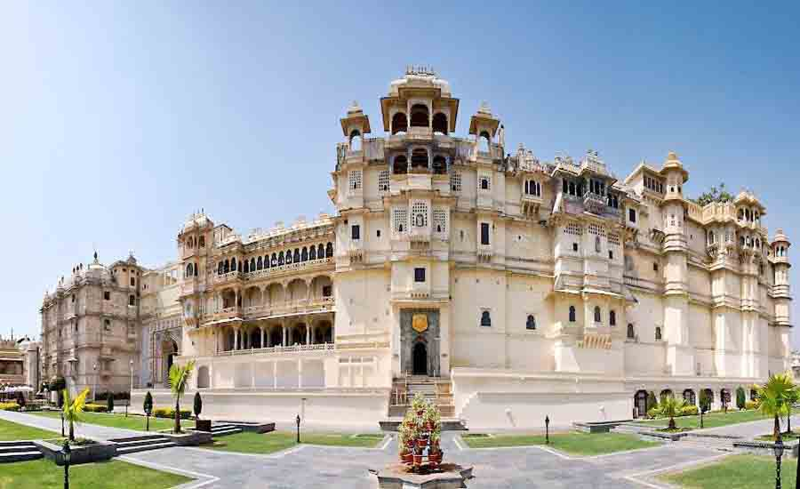

Rajasthan is known as the "Land of Kings" or "Land of Maharajas" and is the largest state of India. The glory of the state is retained by its majestic palaces, forts and monuments, built in different eras throughout history. The vibrant culture and rich heritage of this princely state draw innumerable tourists from across the globe.

A trip to Rajasthan offers a once-in-a-lifetime experience for every traveler. The major architectural wonders include the "Pink City" of Jaipur, which houses a number of well-known tourist spots such as the Hawa Mahal (Palace of Winds) and Amber Fort — the largest fort in Asia — along with Mehrangarh Fort at Jodhpur, and the City Palace and Lake Palace in Udaipur.

## Fairs, festivals and geography

Rajasthan tour packages in India offer a chance to explore the stupendous geographical diversity. The state also hosts colourful fairs and festivals known for their uniqueness, which captivate a large number of tourists from India and overseas every year — among them the Pushkar Camel Fair, Jaipur Literature Festival, Jodhpur Flamenco Gypsy Festival, Jaipur Heritage International Festival, Desert Festival, Holi (the Festival of Colours) and Teej — giving you a whole new experience and making your trip to Rajasthan a memorable one. Come and experience the rich history and beautiful culture of the state with a tour arranged by a Rajasthan tour and travel company in India.

## Temples and sacred sites

Religious sites like the Dilwara Jain Temples in Mount Abu, the Nathdwara Temples in Udaipur and the Kalika Mata Temple in Chittorgarh, among others, provide a glimpse into the religious practices of the state.

## Wildlife in Rajasthan

There are numerous national parks and wildlife sanctuaries in Rajasthan. For travelers who wish to combine wildlife and culture, we recommend visiting Rajasthan to see migratory birds, tigers and several other rare animals found only in its national parks and sanctuaries. Among the best-known are **Ranthambore National Park, Desert National Park, Sariska Wildlife Sanctuary and the Bharatpur Bird Sanctuary** — famous for their tiger population and considered ideal places for wildlife lovers and photographers. The best wildlife tours in Rajasthan take you by jeep or canter safari close to the untamed and unpredictable jungle life, and Rajasthan is among the best places in India for a wildlife photography tour.

Rajasthan is remarkably rich in wildlife heritage. Although the terrain is hostile, the state is home to numerous endangered species including tigers and leopards. Rajasthan wildlife means Ranthambore National Park, defined by its tigers, and amongst other creatures you can glimpse leopard, hyena, jackal, marsh crocodile and various species of deer. In the National Park you will also find the great Indian bustard, and other beautiful animals include chinkara, wolf, blackbuck and Indian fox. The flora and fauna of Rajasthan are unique and diverse — plan a vacation here and capture the moments of life.
